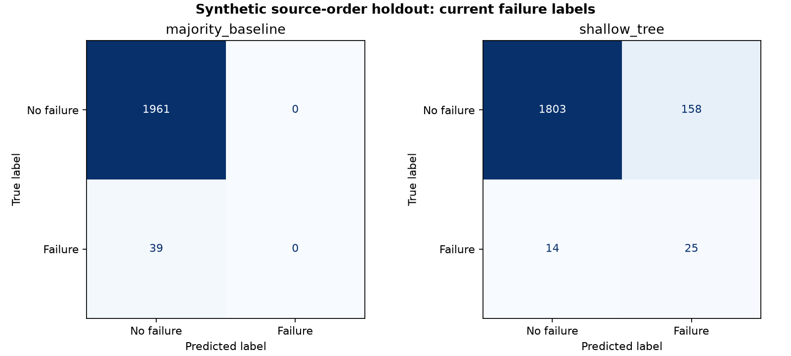
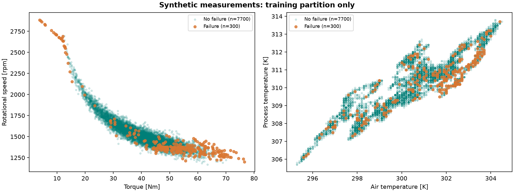
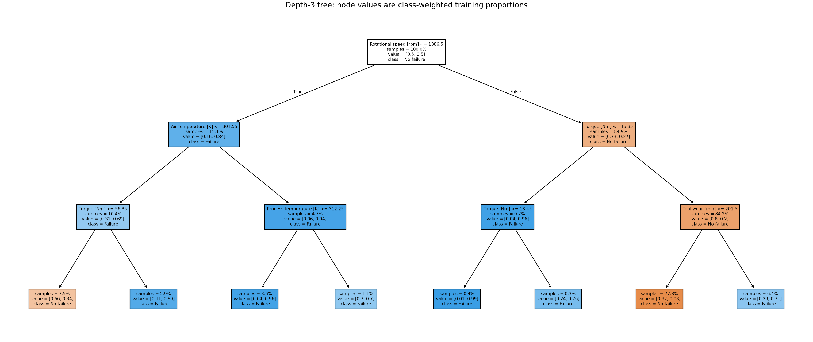

# Predictive Maintenance Explorer

A source-order equipment-condition classification experiment using a majority baseline and an interpretable class-weighted decision tree, with explicit positive-class errors and source-label reconciliation.

> Prediction boundary: the public AI4I data is synthetic and labels current conditions. The experiment does not measure advance warning, remaining useful life or real-equipment reliability.

## Contents

- [Overview](#overview)
- [Dataset and data contract](#dataset-and-data-contract)
- [Architecture and components](#architecture-and-components)
- [Processing pipeline](#processing-pipeline)
- [Configuration and metric definitions](#configuration-and-metric-definitions)
- [Recorded results and evidence](#recorded-results-and-evidence)
- [Interpretation and operational use](#interpretation-and-operational-use)
- [Running locally](#running-locally)
- [Validation and reproducibility](#validation-and-reproducibility)
- [Project structure](#project-structure)
- [Technology stack](#technology-stack)
- [Limitations and next steps](#limitations-and-next-steps)
- [Further technical documentation](#further-technical-documentation)

## Overview

Which measurement observations indicate **current failure conditions** that an operations team might investigate?

## Dataset and data contract

- Public source: [UCI AI4I 2020 Predictive Maintenance Dataset](https://archive.ics.uci.edu/dataset/601/ai4i+2020+predictive+maintenance+dataset), **10,000 synthetic observations and 14 source columns**.
- Attribution: AI4I 2020 Predictive Maintenance Dataset [Dataset]. (2020). UCI Machine Learning Repository. [DOI: 10.24432/C5HS5C](https://doi.org/10.24432/C5HS5C). License: [CC BY 4.0](https://creativecommons.org/licenses/by/4.0/).
- The unchanged [original CSV](data/ai4i2020.csv) is bundled. [data/SOURCE.md](data/SOURCE.md) records source, checksum, units and label handling.
- There are **9,661 non-failure labels and 339 failure labels**: overall failure prevalence **3.39%**. All observations are retained and the source has no missing values.
- The source generator's random seed is unknown to this project. The data is fixed by checksum; **42** is the decision tree's seed, not a claim about generating the original simulation.

| Field | Meaning / use |
|---|---|
| Type | Product quality variant L/M/H; categorical input |
| Air temperature [K] | Ambient measurement in kelvin; numeric input |
| Process temperature [K] | Process measurement in kelvin; numeric input |
| Rotational speed [rpm] | Rotation measurement; numeric input |
| Torque [Nm] | Torque measurement; numeric input |
| Tool wear [min] | Reported wear in minutes; numeric input, not remaining life |
| Machine failure | Original binary target; positive class is 1 |
| UDI / Product ID | Source identifiers, retained for traceability but excluded from features |
| TWF / HDF / PWF / OSF / RNF | Auxiliary tool-wear, heat-dissipation, power, overstrain and random-failure outcome flags; all excluded |

**Label audit:** 27 rows disagree between the main target and the union of the five auxiliary flags: nine main-label positives have no flag, and 18 flagged rows have a zero main label. The project preserves the published main target. It does not silently regenerate labels from the flags or train with those outcome columns.

## Architecture and components


| Component | Entry points or assets | Responsibility |
|---|---|---|
| [main.py](main.py) | load_data / split_source_order | Verify source bytes, label disagreements and the fixed UDI-order split. |
| [main.py](main.py) | build_tree | Encode Type and fit the bounded class-weighted tree without identifier/outcome features. |
| [main.py](main.py) | binary_metrics / evaluate | Compute positive-class precision/recall/F1, balanced accuracy and confusion counts. |
| [main.py](main.py) | save_charts | Export training-only measurement exploration, the fitted tree and holdout confusion matrices. |
| [test_maintenance.py](test_maintenance.py) | Automated checks | Verify hand-calculated metrics, identifier/label exclusion, train-only fitting and repeatability. |

## Processing pipeline

1. Verify source bytes, expected shape, sequence, missingness and label codes. Record target/flag discrepancies without altering labels.
2. Preserve source order: train on **UDI 1-8,000** and test on **UDI 8,001-10,000**. The source contains ordered random-walk signals, so a random row shuffle is avoided. This is an ordered simulation holdout, not a dated operational forecast.
3. Whitelist the six legitimate inputs. Fit numeric median and categorical most-frequent imputation on training data only, then one-hot encode Type. Original inputs are complete, so imputation is inactive. Trees do not need feature scaling; measurement thresholds remain in original units.
4. Fit a majority-class baseline and one [DecisionTreeClassifier](https://scikit-learn.org/stable/modules/generated/sklearn.tree.DecisionTreeClassifier.html) with fixed `max_depth=3`, `min_samples_leaf=20`, `class_weight='balanced'` and seed 42. No parameter/threshold search uses the holdout.
5. Score failure precision, recall and F1, plus accuracy, balanced accuracy and confusion counts. Treat class 1 consistently as failure; zero predicted positives give precision/recall/F1 of zero for the baseline.
6. Export test predictions, audit/split summaries, feature importances, text rules and figures. Measurement exploration charts use the training partition only.

Class balancing gives rare failures more influence while fitting. The exported `weighted_tree_score` is a weighted leaf-class fraction; it is **not a calibrated real-world failure probability**. The default class decision is used without tuning on test labels.

## Configuration and metric definitions

| Setting or measure | Definition |
|---|---|
| Inputs | Type plus five measurements: air/process temperature, rotation speed, torque and tool wear |
| Excluded fields | UDI, Product ID and all five auxiliary failure-mode labels |
| Positive class | Published `Machine failure == 1` |
| Tree | `max_depth=3`, `min_samples_leaf=20`, `class_weight="balanced"`, seed 42 |
| Precision | `TP / (TP + FP)` |
| Recall | `TP / (TP + FN)` |
| F1 | Harmonic mean of positive-class precision and recall |
| Balanced accuracy | Mean of failure recall and non-failure recall |

The majority baseline predicts no failures and receives zero positive-class precision/recall/F1 under the implemented zero-division convention. Tree scores are weighted leaf-class fractions rather than calibrated failure probabilities. No test-set threshold search or relabeling from auxiliary outcome flags is performed.

## Recorded results and evidence

The fixed source-order split contains **300 failures / 8,000 training rows (3.75%)** and **39 failures / 2,000 test rows (1.95%)**. This prevalence shift is retained rather than hidden by stratifying/shuffling the sequence.

| Method | Accuracy | Balanced accuracy | Failure precision | Failure recall | Failure F1 |
|---|---:|---:|---:|---:|---:|
| Majority baseline | 98.05% | 50.00% | 0.00% | 0.00% | 0.0000 |
| Shallow tree | 91.40% | 78.02% | **13.66%** | **64.10%** | **0.2252** |

These values were computed by running the project. Accuracy alone would favor a baseline that misses every failure. The tree retrieves some failures but produces many false alerts; this is a limited synthetic triage experiment rather than a validated maintenance system.

| Tree holdout outcome | Count |
|---|---:|
| Correct non-failure labels (TN) | 1,803 |
| Non-failures flagged as failures (FP) | 158 |
| Failures missed (FN) | 14 |
| Failures detected (TP) | 25 |

The tree flags **183 observations**, of which **25** match the main failure label. It detects **25 of 39 failures** and misses 14. No actual machine inspection, downtime reduction or cost saving was measured.





The training chart shows associations within the synthetic generator's measurements, not real-factory causal effects. UCI's simulation rules contribute to the observed patterns.



The fitted tree has **depth 3 and eight leaves**. In its plot, `value` shows **class-weighted training proportions**; it must not be read as raw failure prevalence. Node sample percentages describe the training sample, while the 50/50 root values arise from class weighting. For rule inspection, [plain-text rules](outputs/decision_rules.txt) are easier to inspect than a zoomed-out figure. `class: 1` means a failure flag under this model.

Evidence: [metrics](outputs/metrics.json), [comparison table](outputs/model_comparison.csv), [test predictions](outputs/holdout_predictions.csv), [split summary](outputs/split_summary.csv), [source audit](outputs/data_audit.json), [feature importance](outputs/feature_importance.csv) and [verification record](outputs/verification.md).

Feature importance is the tree's training impurity-reduction measure. It is neither a causal effect nor proof that an unused feature is irrelevant to actual equipment.

## Interpretation and operational use

- **Evaluate failures directly:** the 98.05%-accurate baseline detects zero failures. Keep recall, precision, F1 and counts alongside accuracy in any maintenance experiment.
- **Account for false-alert workload:** the shallow tree detects 25 failures but flags another 158 non-failures and misses 14 failures. Use those counts to discuss investigation capacity; real operating thresholds would require independent validation and actual error costs.
- **Resolve data meaning before operational use:** retain the 27 main-label/flag disagreements visibly and request source clarification. A genuine advance-warning project would also need dated measurement histories, independent machine identities and a defined future horizon. No future warning performance is established here.

## Running locally

Prerequisite: **Python 3.12+** and a terminal; verified with Python 3.12. No paid API, cloud account, GPU, model runtime, database server or other project folder is needed. From the repository root, run these three commands in your Python environment:

```powershell
cd projects/10-predictive-maintenance-explorer
python -m pip install -r requirements.txt
python main.py
```

The source is bundled for offline data use. If absent, the official small archive is downloaded and checksum-verified. A changed source fails explicitly; `.gitattributes` preserves original CSV bytes across Git checkouts. No large model binary is necessary.

Optional verification, separate from launching: `python -m unittest -v`. This is a local script and saved figures, so no web service is required.

## Validation and reproducibility

The automated suite contains **6 tests**. It checks the following implementation boundaries:

Test implementation: [test_maintenance.py](test_maintenance.py).

- Source labels and integrity.
- Source order split.
- Hand calculated positive class metrics.
- Ids and failure modes cannot change predictions.
- Holdout labels do not fit preprocessing or model.
- Confusion counts and reproducibility.

From the project directory, run:

```powershell
python -m unittest -v
```

Recorded execution and any browser-review evidence is retained in [outputs/verification.md](outputs/verification.md). Reported figures correspond to saved execution artifacts; running a report generator can overwrite its generated outputs. Package requirements, source checksums and fixed parameters define the reproducibility boundary; elapsed times and some model/solver outputs can vary across environments.

## Project structure

```text
10-predictive-maintenance-explorer/
  main.py
  PROJECT_FILES.md
  README.md
  requirements.txt
  test_maintenance.py
  data/
    Bundled inputs, provenance and prepared data
  outputs/
    Recorded metrics, audit files, tables and figures
```

Generated environments, database files, model artifacts and compiled assets follow the project's [.gitignore](.gitignore). The [copyable source bundle](PROJECT_FILES.md) mirrors the README and contains individual file blocks.

## Technology stack

Python, NumPy, pandas, scikit-learn Pipeline/ColumnTransformer, SimpleImputer, OneHotEncoder, DummyClassifier, DecisionTreeClassifier and classification metrics; matplotlib; standard-library unittest/hashlib/urllib/zipfile. Direct dependencies are pinned in [requirements.txt](requirements.txt).

## Limitations and next steps

- The source is synthetic, generated using designed failure relationships; the model partly learns that simulation. Results do not validate performance on actual machinery.
- The target is a current-condition label. There is no future warning interval, remaining useful life or calendar-dated forecasting task.
- Only 39 holdout failures support the reported failure metrics. One fixed split is limited evidence; no confidence intervals, calibration or production validation were performed.
- Ordered holdout reduces random mixing of sequence-related measurements but does not prove independent machine or temporal generalization. Actual dates and independent equipment histories are unavailable.
- Source main-label/auxiliary-flag disagreements are retained. Errors or undocumented labeling differences can affect fitting and evaluation.
- The tree's low precision creates substantial false-alert workload. Balanced class weights and weighted scores are not real-world risk calibration or a policy chosen from actual costs.
- Fixed depth/leaf settings keep the model explainable but can miss interactions and uncommon failure modes. No test-set tuning, oversampling or alternate classifier search was performed.
- Complete source measurements mean imputation is inactive; it is a reusable training-only preprocessing step, not evidence of repaired missing telemetry.
- No automated maintenance action, real-world downtime reduction, safety guarantee, inspection outcome or financial saving was measured. Future work should begin with a suitable dated real dataset and independently defined operating criteria.

## Further technical documentation

- [Dataset attribution, licensing and source transformations](data/SOURCE.md)
- [Pinned Python dependencies](requirements.txt)
- [Recorded execution and verification evidence](outputs/verification.md)
- [Folder structure and individually copyable source files](PROJECT_FILES.md)

[Back to contents](#contents)
